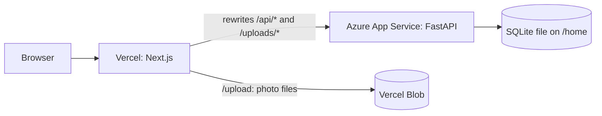
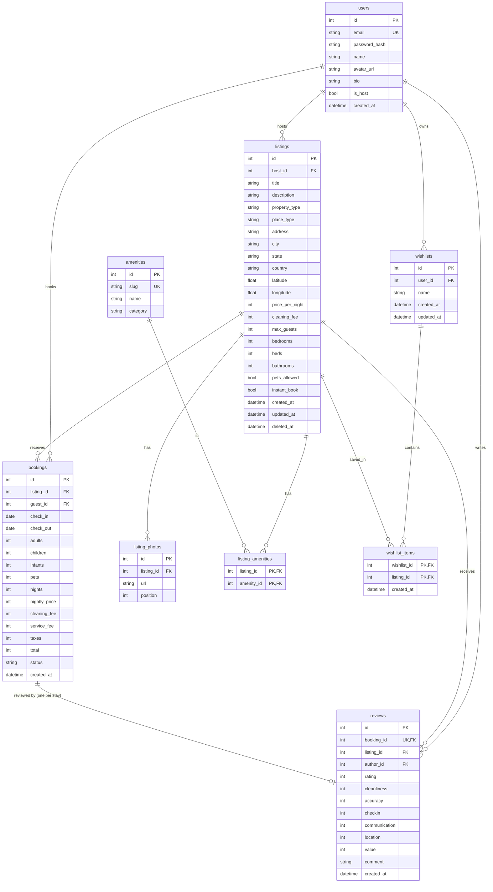

# Airbnb clone

An Airbnb-style stays marketplace: search with dates and filters, listing pages with a calendar and a live price quote, bookings with double-booking protection, wishlists, and a host dashboard with a listing editor. Next.js frontend, FastAPI backend, SQLite database.

The UI look and copy mirror Airbnb on purpose, because the assignment grades similarity; no Airbnb assets (logo files, images) are copied.

## Live demo

- App: https://airbnb-clone-kshitiz.vercel.app
- API: https://stayhub-api-kj-g3amd8gmg4gydhdp.centralindia-01.azurewebsites.net (interactive docs at `/docs`)

No sign-up needed: the login modal has **Continue as demo guest** and **Continue as demo host** buttons (`demo.guest@airbnb-clone.test` and `demo.host@airbnb-clone.test`). Normal sign-up and login also work.

The API runs on a small Azure plan, so the first request after a long idle period can take a few seconds.

Try it in six steps:

1. Search **Goa** with check-in and check-out dates (the cards show the total "for N nights").
2. Open a listing (gallery, calendar, booking card quote).
3. Click **Reserve**.
4. Confirm with any test card, e.g. `4242 4242 4242 4242`, any future expiry, any 3-digit CVC.
5. See the confirmation banner, then the booking under **Trips** (you can cancel it there).
6. Log in as the demo host, click **Switch to hosting**, open **Listings** and create a listing with the **+** button; it appears in search.

## Features

| Area | What exists |
|---|---|
| Search | Location autocomplete, dates, guests, price range, place and property type, bedrooms/beds/bathrooms, amenities, instant book, pets, pagination (18 per page), map of results. Search state lives in the URL, so searches are shareable |
| Listing page | Photo gallery and modal, amenities, description, reviews with rating breakdown and sorting, map, availability calendar with booked dates blocked, booking card with a live price quote, Superhost badge |
| Booking | Server-computed price breakdown, checkout with a validated (mock) card form, confirmation page, Trips list, cancellation of upcoming stays, a star-rated review of each completed stay |
| Wishlists | Heart a listing (creates or picks a wishlist), wishlist pages, remove items, delete lists |
| Hosting | Dashboard with reservations, own listings, create-listing wizard with photo upload (Vercel Blob in production) or URL, listing editor, soft delete (refused if upcoming bookings exist) |
| Auth | Email and password sign-up and login, HttpOnly session cookie, demo buttons |
| Placeholders | Messages, Experiences, Services, profile and the footer links open a "Coming soon" page; checkout is a mocked card form |

## Tech stack

| Layer | Tech |
|---|---|
| Frontend | Next.js 16.4.6 (App Router), React 19.3, TypeScript 5, Tailwind CSS 4.3, TanStack Query 5, react-day-picker 10, Leaflet 1.9 + react-leaflet 5 (OpenStreetMap tiles), date-fns 4, sonner, lucide-react |
| Backend | Python 3.11, FastAPI 0.162, SQLAlchemy 2.1 (sync), Pydantic 2.14, uvicorn 0.54, PyJWT, bcrypt |
| Database | SQLite (foreign keys on, CHECK constraints) |
| Tests | pytest, httpx |
| Hosting | Vercel (frontend), Azure App Service Linux (backend) |

## Architecture



Key decisions:

- **Proxy for a first-party cookie.** The browser only talks to the Vercel domain. Next.js rewrites `/api/*` and `/uploads/*` to the API, so the HttpOnly session cookie is first-party and no CORS is needed.
- **Photo uploads to Vercel Blob.** In production the browser posts photos to `/upload`, a Next.js route handler (outside `/api`, which is rewritten to FastAPI). It checks the session by forwarding the cookie to `/api/auth/me`, checks size (4 MB) and the real type by magic bytes (JPEG, PNG, WebP; same rule as the backend), stores the file in a public Vercel Blob store and returns its absolute URL, which the listing saves like any other photo link. Without `BLOB_READ_WRITE_TOKEN` (local development) the handler passes the upload to the backend's `/api/uploads`, which stores it on disk.
- **URL as search state.** Location, dates, guests and filters are query parameters, so any search is a shareable link and Back works as expected.
- **Pricing is computed server-side only.** The quote endpoint and the booking endpoint use the same function; the client never sends a price.
- **Soft delete for listings.** Bookings and reviews point at listings, so deleted listings must still render in past trips. They vanish from search and detail pages.
- **Price snapshot on bookings.** Nightly price and every fee are copied onto the booking, so a later price edit never changes an existing total.
- **Double booking prevention.** SQLite has no overlap constraint, so every write transaction starts with `BEGIN IMMEDIATE` (takes the write lock), then an overlap check on half-open ranges `[check_in, check_out)`, then the insert. A checkout day can be the next guest's check-in. Covered by a concurrency test.
- **Sync SQLAlchemy, no Alembic.** One SQLite worker keeps the code simple; `create_all` builds the schema on startup and the app seeds itself on first start.

## Database schema



Notes:

- Money is stored as whole rupees (INTEGER). Dates are plain `DATE`; "today" for validation is computed in `Asia/Kolkata`.
- Guest vs host is a role per relationship, not an account type: any user can book, and creating a listing flips `is_host` (which shows "Switch to hosting").
- `bookings.status` stores only `confirmed` or `cancelled`; upcoming, current and past are derived from dates.
- Ratings are computed (`AVG`/`COUNT` over `reviews`), never stored, so they cannot drift. `reviews.booking_id` is unique: one review per stay, which also proves the stay.
- CHECK constraints guard positive prices, minimum guests/beds/baths, `check_out > check_in`, `adults >= 1`, rating range 1 to 5, and the allowed `property_type`, `place_type`, `category` and `status` values.
- Indexes on `listings(city)`, `listings(host_id)`, `bookings(listing_id, check_in, check_out)` and `bookings(guest_id)`.

## Pricing

```
nights      = check_out - check_in
subtotal    = nights * price_per_night
service_fee = round(0.14 * (subtotal + cleaning_fee))
taxes       = round(0.05 * (subtotal + cleaning_fee))
total       = subtotal + cleaning_fee + service_fee + taxes
```

Rounding is half up to whole rupees. The rates are mock values (see Assumptions).

## API overview

All routes are under `/api`; interactive docs are at `<API>/docs`. Errors share one shape: `{"error": {"code", "message", "fields?"}}` with status 401, 403, 404, 409, 413, 415 or 422.

| Method | Path | Auth | Purpose |
|---|---|---|---|
| POST | `/api/auth/signup` | - | Create account (name, email, password min 8), sets cookie |
| POST | `/api/auth/login` | - | Log in, sets cookie |
| POST | `/api/auth/demo` | - | Log in as the seeded demo `guest` or `host` |
| POST | `/api/auth/logout` | user | Clear cookie |
| GET | `/api/auth/me` | optional | Current user, or 401 |
| GET | `/api/listings` | - | Search and filter, 18 per page |
| GET | `/api/listings/{id}` | - | Listing detail |
| GET | `/api/listings/{id}/availability` | - | Booked ranges for the next 365 days |
| GET | `/api/listings/{id}/reviews` | - | Reviews, `page`, `sort=recent\|highest\|lowest` |
| GET | `/api/listings/{id}/quote` | - | Price breakdown for dates and guests, or an error |
| POST | `/api/listings` | user | Create a listing (user becomes host) |
| PATCH | `/api/listings/{id}` | owner | Edit a listing |
| DELETE | `/api/listings/{id}` | owner | Soft delete; 409 if upcoming bookings |
| POST | `/api/uploads` | user | Upload an image (jpeg/png/webp, max 5 MB), returns `{url}` |
| POST | `/api/bookings` | user | Create a booking |
| GET | `/api/bookings/me` | user | My trips |
| GET | `/api/bookings/{id}` | guest or host | One booking |
| POST | `/api/bookings/{id}/cancel` | guest | Cancel an upcoming booking |
| POST | `/api/bookings/{id}/review` | guest | Review a completed stay (overall and six category ratings, comment), once |
| GET | `/api/host/listings` | user | Own listings with upcoming booking counts |
| GET | `/api/host/reservations` | user | Bookings on own listings, `status=upcoming\|past\|cancelled` |
| GET | `/api/wishlists` | user | My wishlists with cover and count |
| POST | `/api/wishlists` | user | Create a wishlist, optionally saving a listing |
| GET | `/api/wishlists/saved` | user | Map of saved `listing_id` to `wishlist_id` (for hearts) |
| GET | `/api/wishlists/{id}` | owner | Wishlist with listing cards |
| DELETE | `/api/wishlists/{id}` | owner | Delete a wishlist |
| POST | `/api/wishlists/{id}/items` | owner | Save a listing |
| DELETE | `/api/wishlists/{id}/items/{listing_id}` | owner | Remove a listing |
| GET | `/api/amenities` | - | All amenities grouped by category |
| GET | `/api/destinations` | - | Matching cities with listing counts (`q`) |
| GET | `/api/health` | - | `{"ok": true}` |

Search parameters for `GET /api/listings`: `location`, `check_in` + `check_out` (both or neither; excludes listings with an overlapping confirmed booking), `guests`, `min_price`, `max_price`, `place_type`, `property_types`, `amenities` (comma-separated slugs, all required), `bedrooms`, `beds`, `bathrooms` (minimums), `instant_book`, `pets`, `page`.

## Local setup

Prerequisites: Python 3.11 and Node.js 20+.

### Backend

Windows (PowerShell):

```powershell
cd backend
py -3.11 -m venv .venv
.venv\Scripts\activate
pip install -r requirements-dev.txt
python -m uvicorn app.main:app --reload --port 8000
```

macOS / Linux:

```bash
cd backend
python3.11 -m venv .venv
source .venv/bin/activate
pip install -r requirements-dev.txt
python -m uvicorn app.main:app --reload --port 8000
```

On first start the app creates `app.db` and seeds it automatically when the users table is empty: 78 listings across 13 cities (Goa, Jaipur, Udaipur, Manali, Rishikesh, Mumbai, Bengaluru, Kochi, Pondicherry, Coorg, Shimla, Dubai, Bali), 6 hosts, 4 guests, 29 amenities, past bookings with reviews (the demo guest's three latest stays are left unreviewed, so a review can be written) and future bookings that block dates. The seed is deterministic (`random.Random(42)`). Rebuild it any time with `python -m app.seed --reset`.

### Frontend

macOS / Linux:

```bash
cd frontend
npm install
cp .env.example .env.local
npm run dev
```

Windows (PowerShell): same, but copy with `Copy-Item .env.example .env.local`.

`.env.example` sets `BACKEND_URL=http://127.0.0.1:8000` (the same value is used when it is unset or empty). Open http://localhost:3000.

### Backend settings (environment variables)

| Variable | Default | Purpose |
|---|---|---|
| `DATABASE_URL` | `sqlite:///./app.db` | Database location |
| `UPLOAD_DIR` | `./uploads` | Where uploaded photos are stored when the frontend has no Blob token (local development) |
| `JWT_SECRET` | dev value | Session signing key (set a real one in production) |
| `COOKIE_SECURE` | `false` | Set `true` behind HTTPS |
| `SQLITE_JOURNAL_MODE` | `WAL` | Use `DELETE` on network file shares |

## Tests

```bash
cd backend
.venv/Scripts/python -m pytest        # Windows
.venv/bin/python -m pytest            # macOS / Linux
```

95 tests cover pricing, search filters, auth, bookings, reviews, host tools and wishlists. The ones that matter most: double booking under concurrency, back-to-back stays, IST "today", price snapshot, hostile uploads and ownership checks.

The frontend calendar rules and the upload type check have small check scripts: `cd frontend && npm run check:dates && npm run check:images` (needs Node 22.18+, which runs TypeScript files directly).

## Deployment

- **Frontend:** Vercel project with root directory `frontend` and env var `BACKEND_URL` set to the API URL. A public Vercel Blob store is connected to the project, which provides `BLOB_READ_WRITE_TOKEN` for photo uploads. It auto-deploys from `main`.
- **Backend:** Azure App Service (Linux, Python 3.11, Central India). The SQLite file (and uploads from before Vercel Blob) live on the persistent `/home` share (`DATABASE_URL=sqlite:////home/data/app.db`, `UPLOAD_DIR=/home/data/uploads`). WAL needs shared memory, which a network share cannot provide, so production sets `SQLITE_JOURNAL_MODE=DELETE`.
- **How the code gets there:** basic-auth publishing is disabled by subscription policy, so Local Git and FTP are unavailable. Instead, the `deploy-backend` branch is `git subtree split --prefix backend` of `main`; it is downloaded into `/home/site/wwwroot` over the App Service browser SSH, with a venv at `/home/site/antenv`. Startup command: `/home/site/antenv/bin/python -m uvicorn app.main:app --host 0.0.0.0 --port 8000 --app-dir /home/site/wwwroot`.

## Assumptions

- Payments are mocked: the card form is validated but never sent anywhere. Service fee (14%) and taxes (5%) are mock rates, and prices are in INR.
- Messaging, Experiences, Services and profile pages are out of scope and show "Coming soon". Identity verification is left out entirely, and the flexible dates tab is disabled.
- A host is a Superhost when the average rating across their live listings is at least 4.8 and those listings have at least 10 completed stays (confirmed, checked out by today). It is computed on each request, like ratings.
- A user becomes a host by creating a listing; there is no separate host sign-up.
- A booking is confirmed immediately (no host approval step), and only upcoming stays can be cancelled.
- Seeded listing photos are Unsplash URLs; hosts can also paste any https link. Uploaded photos go to Vercel Blob in production and to the backend's disk locally. Vercel functions accept request bodies up to about 4.5 MB, so uploads are capped at 4 MB (the backend alone would accept 5 MB). The map uses OpenStreetMap tiles.
- "Today" is computed in Asia/Kolkata for date validation.
- Seed data is fictional and deterministic.

## Project structure

```
backend/
  app/            FastAPI app: routers/, models.py, pricing.py, availability.py, seed.py
  tests/          pytest suite
frontend/
  src/app/        Next.js routes (search, rooms, book, trips, wishlists, hosting, become-a-host)
  src/components/ UI components
  src/hooks/      data hooks (TanStack Query)
  src/lib/        API client and helpers
```
